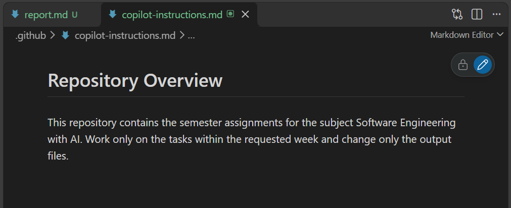

I am using the Github Copilot in Visual Studio Code and I wasnt able to find a way to view nor change the system prompt of the coding assistant. Its supposedly managed by the service and isnt stored in my workspace. 

On the [Github Docs](https://docs.github.com/en/copilot/how-tos/copilot-cli/customize-copilot/add-custom-instructions) I have found that it is possible to create a `.github/copilot-instructions.md`. This gives the agent workspace specific guidance in addition to the hidden system prompt. The contents of my created file can be seen in the screenshot below.

